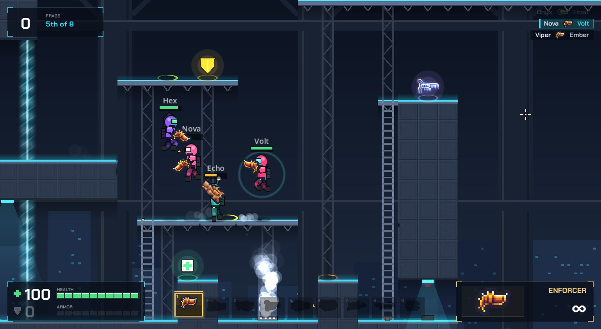
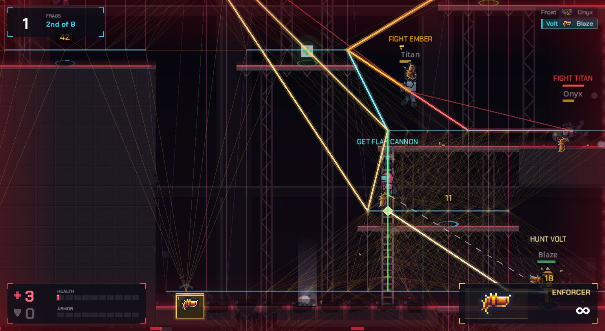
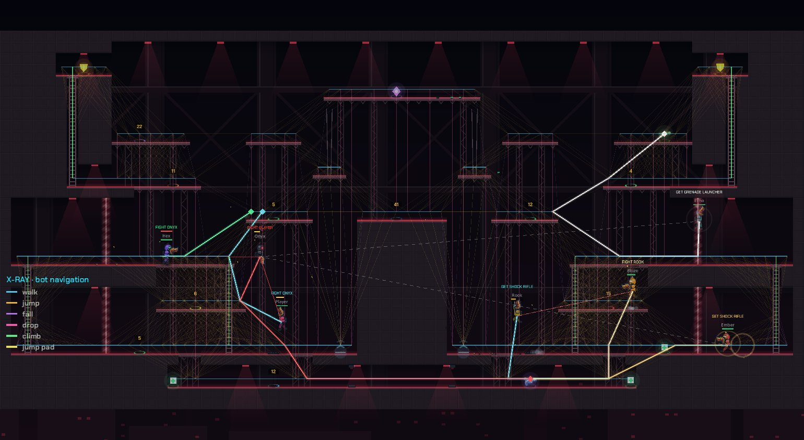
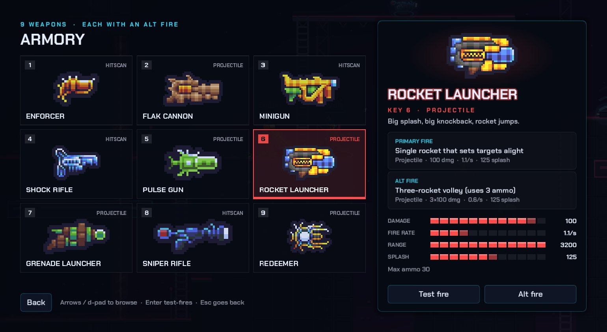
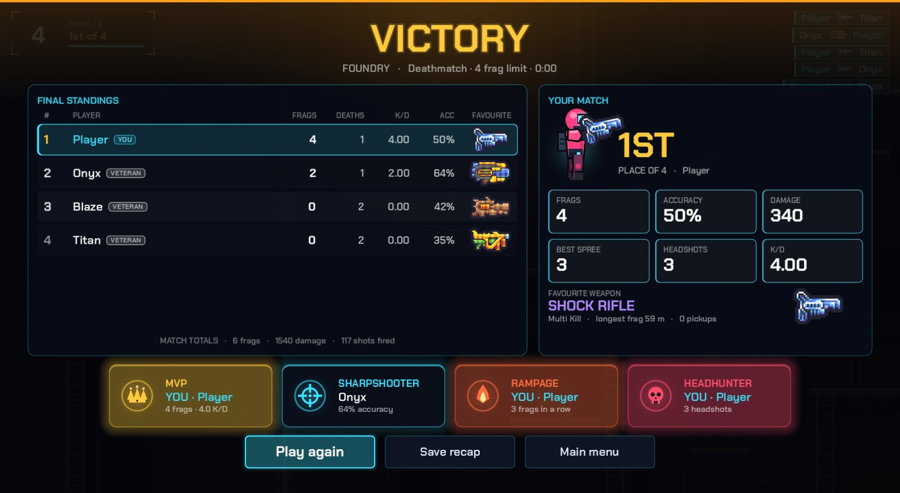
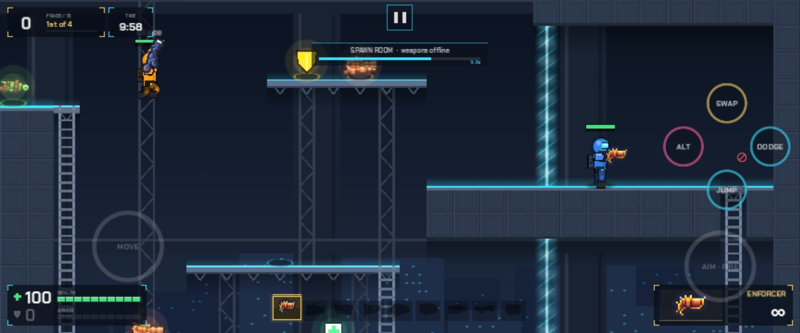
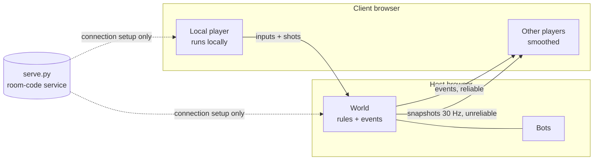

<div align="center">

# FRAGLINE

**Fast, neon 2D arena combat that runs in your browser, with bots and LAN multiplayer built in.**

A modern tribute to the Newgrounds classic *Unreal Flash*, built from scratch in Godot 4.7 for the HackInverse 1.0 hackathon.


**[▶ Watch the 60-second trailer](docs/media/fragline-trailer.mp4)** (1080p, real gameplay)

</div>

## Why FRAGLINE

- **Opens in a browser tab.** No install and no plugins. It runs on WebGL 2 using Godot's no-threads web build, so it works on any static host without special server headers.
- **Runs at full refresh rate on a budget laptop.** Measured in Chrome on an Intel i3-1215U with integrated Intel UHD graphics: 8 fighters hold a steady 68 FPS (the display's refresh rate, up from 17-20 FPS) at about 40 draw calls a frame. See [Performance](#performance).
- **See what's normally invisible.** Press **X** for X-Ray vision: the bots' navigation graph, each bot's planned route and goal, what it's trying to do ("GET ROCKET LAUNCHER", "HUNT VOLT"), who it's targeting, and respawn timers on taken items.
- **Play on your phone.** The LAN lobby shows a QR code. Scan it, and the game opens in your phone's browser with twin-stick touch controls and aim assist.
- **Small download.** The game data (art, levels, sound and music) is about 6.5 MB. Characters, levels and effects are drawn in code. Weapons use a CC0 pixel-art pack.
- **Bots that play properly.** Bots find their way around every arena using ladders, jump pads and drop-through floors. They pick up items, avoid traps, lead their shots and dodge. There are five skill levels, from Rookie to Godlike.
- **LAN multiplayer with a room code.** Host a match and share a 6-character code. Up to 8 players connect directly to each other, browser to browser, over WebRTC.
- **Tested.** Eleven headless test suites cover combat rules, regressions, menus, bot navigation, full bot matches on every arena, game modes, touch controls, the announcer, audio, sound hooks and match stats.

## New in 2.0

- **Locked frame rate on integrated graphics:** 17-20 FPS → 68 FPS in Chrome on an Intel UHD laptop (batched rendering, baked level meshes).
- **X-Ray vision**, **phone play with QR join**, **game modes** (Gun Game, Instagib, Rocket Arena, Low Gravity) and a 7th arena, **Blackout Relay**.
- **Pixel-art weapons** and **real weapon audio** from third-party packs (credited in [CREDITS.md](CREDITS.md)).
- **Game feel:** casings, impacts, layered explosions, recoil, hit-stop, slow-motion final kill, death cam, and an Unreal-style announcer.
- **New screens:** animated main menu, Armory, results with awards and a downloadable recap card, branded loading page.
- **Hardened LAN server** and about 40 bug fixes, with 11 headless test suites. Full list in [CHANGELOG.md](CHANGELOG.md).

## Screenshots

| In a match | X-Ray vision |
|---|---|
|  |  |
| **Blackout Relay with X-Ray (whole arena)** | **Armory** |
|  |  |
| **Results** | **Match setup** |
|  |  |
| **Phone (touch controls)** | |
|  | |

## Features

### Combat
- **9 weapons, each with an alternate fire mode:** Enforcer, Flak Cannon, Minigun, Shock Rifle (beam + combo ball), Pulse Gun, Rocket Launcher (volleys, rocket jumps), Grenade Launcher (sticky grenades), Sniper Rifle (headshots, wall-piercing shot) and the Redeemer.
- **Movement:** double jump, dodge-roll, drop-through platforms, ladders you can grab in mid-air, and jump pads.
- **Status effects:** burning, poisoned, chilled and jammed.
- **Smooth on fast screens:** physics runs at 60 Hz and rendering is interpolated, so the game stays smooth on 120 and 144 Hz displays.
- **Game feel:** shell casings that bounce, a different muzzle flash for each weapon, wall sparks with scorch marks that cool, layered explosions (a staged mushroom cloud for the Redeemer), rocket smoke trails, recoil camera kick, a short hit-stop on your kills, a slow-motion final kill, and a death cam that follows your killer.
- **Game modes:** Deathmatch, **Gun Game** (each frag moves you up an 8-weapon ladder that ends on the pistol), **Instagib** (shock rifle, one hit kills) and **Rocket Arena**, plus a Low Gravity mutator. Bots play all of them, over LAN too.

### Arenas
- **Seven PvP arenas:** Deck-17, Skyline, Foundry, Overgrowth, Cryo Station, Orbital and **Blackout Relay**, a red emergency-lit relay station with a hidden tunnel under the core and a secret shaft inside the wall (X-Ray shows them). Each arena is mirrored for fairness and has its own hazards: laser gates, floor vents, lava and void.
- **No spawn camping:** spawn rooms sit behind energy barriers and you can't fight inside them. A timer stops players from hiding in them, and you get a short shield when you step out.
- **Training Room:** an armory, a firing range, an agility course, and practice dummies you can set up (idle, moving, attacking or bot opponent), plus god mode and infinite ammo.

### Bots
- They plan routes over a navigation graph that covers walking, jumping, double jumps, drop-throughs, ladders and jump pads.
- They choose what to do (heal, armour up, grab a weapon, hunt, roam) by scoring each option.
- In a fight they pick a weapon for the range, lead moving targets, arc grenades, aim rockets at your feet, set up shock combos, and strafe, hop and dodge.

### Multiplayer (LAN)
- Host or join with a room code, a join link or a **QR code**. Players can join after a match has started. Phones get touch controls automatically.
- Works on plain-HTTP LAN addresses in Chrome, which normally treats them as insecure and blocks the game's audio setup.
- The host's game makes the final call on damage, pickups and scores. It checks each client's fire rate, ammo, weapon ownership and muzzle position.
- Your own movement runs locally, so it never feels laggy. Other players are updated 30 times a second and smoothed between updates. The host's bots fight alongside everyone.

### Presentation
- 12 fighters you can recolour, plus helmets and a live preview.
- Neon lighting, particles and screen shake.
- A full menu flow: an animated start menu over a live bot match with a rotating weapon showcase, an **Armory** with stats and test-fire for every weapon, match setup, settings (audio, graphics, key rebinding, gameplay), pause menu, countdown and an FPS / draw-call counter.
- **Results screen:** final standings with accuracy and favourite weapon, award cards (MVP, Sharpshooter, Rampage, Headhunter and more), and **Save recap**, which downloads a shareable 1200x630 image.
- **Announcer** in the style of Unreal Tournament, using the browser's built-in speech: countdown, first blood, multi-kills, killing sprees, headshots, lead changes, frags and time remaining, and victory.
- **Weapon audio:** real gunshots, shotgun pumps, a rack sound for each weapon when you equip it, robot death sounds, boot footsteps, rocket engine loops, plus kill-confirm and headshot pings. All mixed with per-sound levels and voice limits.
- A branded loading page with progress, tips and a clear message if WebGL 2 is missing.
- **Auto quality:** if a match keeps dropping frames (a laptop on battery saver, say), the game switches to Low quality once and tells you.
- A CC0 soundtrack: a synthwave menu theme and three drum-and-bass / trance tracks shared across the arenas.

## Quick start

### Play in the browser (recommended)

Requires **Godot 4.7.2** on your `PATH` and its **web export templates** (Editor → Manage Export Templates).

```bash
./tools/build_web.sh        # export to build/web/
python3 tools/serve.py      # serve at http://localhost:8000 (also on your LAN, with gzip)
```

### Play on desktop

```bash
godot --path .              # run the game
godot -e --path .           # open the editor
```

### LAN multiplayer

1. On one machine, run `./tools/build_web.sh` and then `python3 tools/serve.py`. It prints a LAN address such as `http://192.168.1.20:8000`.
2. Everyone else opens that LAN address in a browser. The host can use either the LAN address or `http://localhost:8000`: the room's join link and QR code always use the LAN address.
3. The host chooses **Play → Host LAN**, sets up the match and clicks **Host match**. The lobby shows a 6-character room code, a join link and a QR code.
4. Everyone else chooses **Play → Join LAN** and types the room code, opens the join link, or scans the QR code with a phone camera.
5. The host clicks **Start**. Players can also join a match that is already running.

Tips:
- **Venue Wi-Fi often blocks device-to-device traffic** ("client isolation"): the page loads, but players can't connect to each other. Put everyone on a phone hotspot or your own router instead.
- Plain `http://` LAN addresses work in Chrome. Chrome treats them as insecure and hides the audio API Godot normally uses, so the loading page switches to a fallback audio path automatically.
- `python3 tools/serve.py --port 8080` changes the port, `--dir <folder>` serves another build folder, and `--host 127.0.0.1` keeps the server on this machine only.

### Phones and tablets

Open the LAN address (or scan the lobby's QR code) in the phone's browser. Touch controls appear automatically on touch screens:

- **Left half:** a floating move stick. Push up to jump, down to drop through.
- **Right half:** a floating aim stick that fires once pushed past the dead zone, with aim assist.
- **Buttons** around the aim area: Jump, Alt, Dodge and Next weapon. Pause sits at the top.

The first tap switches to fullscreen and asks for landscape. Phones start on Low quality for a steady frame rate.

## Controls

| Action | Keys |
|---|---|
| Move | A / D (or ← / →) |
| Jump, double jump, climb | W / Space / ↑ |
| Drop through, climb down | S / ↓ |
| Dodge | Shift (or S + direction) |
| Fire / alt fire | Left / right mouse button |
| Switch weapon | 1–9, mouse wheel, Q / E |
| Scoreboard | Tab |
| X-Ray vision (offline) | X |
| Pause | Esc / P |
| Training panel | T (in the Training Room) |

You can rebind movement, dodge, weapon cycling, the scoreboard and X-Ray in **Settings → Controls**. X-Ray works offline only (against bots, in the Training Room and in the menu's live match); in LAN games it would be a wallhack. For phones, see [Phones and tablets](#phones-and-tablets).

## Configuration

### In-game settings

Settings apply immediately and are saved to `user://settings.cfg` (in the browser, that's IndexedDB, so they survive reloads).

| Tab | Setting | Notes |
|---|---|---|
| Audio | Master, Music, Sound effects | Volume sliders. |
| Audio | Announcer voice | Spoken callouts through the browser's speech synthesis (web only). |
| Graphics | Quality: Low / High | Low halves particle effects and turns off lamp glow. Phones start on Low. |
| Graphics | Auto quality | On by default: switches to Low once if a match keeps dropping frames. |
| Graphics | Screen shake, Fullscreen, Show FPS counter | The counter also shows frame time and draw calls. |
| Controls | Key rebinding | Movement, dodge, weapon cycling, scoreboard and X-Ray. Taking a key that's in use swaps the two bindings. |
| Gameplay | Auto-switch to new weapons | Switch to a better weapon when you pick it up. |

### Match options

Set on **Play → Versus bots** or **Play → Host LAN**, and remembered for next time:

| Option | Values |
|---|---|
| Arena | Deck-17, Skyline, Foundry, Overgrowth, Cryo Station, Orbital, Blackout Relay |
| Mode | Deathmatch, Gun Game, Instagib, Rocket Arena |
| Mutator | Low gravity (works with any mode) |
| Bots | None to 7 |
| Bot skill | Rookie, Regular, Veteran, Elite, Godlike |
| Frag limit | 5, 10, 15, 20, 25, 30, 50 (Gun Game always uses its 8-weapon ladder) |
| Time limit | None, 5, 10, 15 or 20 minutes. A tie at the time limit is a draw. |

### Server and build

- `tools/serve.py`: `--port` (default 8000), `--host` (default all interfaces; `127.0.0.1` keeps it local) and `--dir` (default `build/web`). Its limits (room and peer caps, rate limits, timeouts) are listed in [SECURITY.md](SECURITY.md).
- `tools/build_web.sh`: `GODOT=`, `OUT=` and `PUBLIC_URL=`; see [Deploying](#deploying).
- `project.godot`: GL Compatibility renderer (WebGL 2), physics at 60 Hz with at most 3 catch-up steps, `allow_hidpi=false` so the canvas renders at CSS pixels, and `canvas_items` stretch over a 1280x720 base.
- URL parameters for the web build are listed in [URL parameters](#url-parameters).

## How it works



- **Events at the core.** The `World` node announces every game event (shots, hits, pickups, kills). Single-player handles those events locally. In multiplayer the host sends the same events to every client, so both modes run the same rules code.
- **Connections.** `tools/serve.py` serves the game and swaps WebRTC connection details using the room code. Once players are connected, game traffic goes straight between browsers and never passes through the server.
- **Levels are plain text.** Each arena is ASCII art in `src/data/maps.gd`, and the game builds collision, decoration, items and the bot navigation graph from it.
- **One place for balance numbers.** Weapons and projectiles live in `src/data/weapons.gd`, status effects in `src/data/status.gd`, trap timings in `src/game/traps.gd`, and game-mode rules in `src/game/game_mode.gd`.

For rendering, networking, bots, audio and the web shell in more depth, see [docs/ARCHITECTURE.md](docs/ARCHITECTURE.md).

## Performance

All numbers are from Chrome on the target laptop: Intel i3-1215U, integrated Intel UHD graphics, 1080p at 125% scaling, display at about 68 Hz. Each test is a 20-second all-bot match with 8 fighters and the HUD on.

| | Before | After |
|---|---|---|
| Average FPS (Deck-17 / Foundry / Cryo Station) | 17.7 / 19.9 / 17.0 | **68 / 68 / 68** (display refresh) |
| 99th-percentile frame time | 80-112 ms | **14.8 ms** |
| Draw calls per frame | 516-1294 | **about 40** |

What made the difference:
- **Batching.** In Godot's GL Compatibility 2D renderer, every `draw_circle`, `draw_polygon`, `draw_polyline` and `draw_arc` is its own draw call and creates new GPU buffers on every redraw. All dynamic drawing (fighters, particles, pickups, projectiles) now uses quads from one shared texture atlas (`DrawUtil`), which Godot batches into a handful of instanced draw calls.
- **Static layers baked once.** Level tiles, decoration and parallax backgrounds are baked into one mesh per layer (`StaticDraw`). On Cryo Station that cut level drawing from 1000 draw calls to 8.
- **Less work each frame.** Pickups and traps only redraw when their state changes, particles are pooled with no per-frame allocation, the living-players list is cached, and nav graphs are built once per map and reused. Sounds are preloaded and registered as web samples so the first shot doesn't stall the frame.
- **Engine settings.** `allow_hidpi=false`, a cap on physics catch-up steps, and the background match behind the menu freezes on sub-screens.

The web build has a benchmark mode built in: open `index.html?bench=20&map=2&bots=7` (add `&xray=1` to include the overlay), and the results are published as `window.__bench`. Desktop builds take `-- --bench=20 --map=2 [--xray] [--bench-quit] [--bench-shot=<file.png>]`; a native run on the same laptop also reports 68 FPS at about 41 draw calls.

For capturing footage, the native benchmark also accepts `--bots=N`, `--mode=N` (0-3), `--skill=N` (0-4), `--seed=N`, `--lowgrav`, `--nohud`, `--sfx` and `--timescale=F`, plus `--size=WxH` (render at that size in a borderless window) and `--frames=DIR` (save every frame as a JPEG; desktop only). The trailer was captured this way.

## URL parameters

The web build reads these from the page address, for example `http://192.168.1.20:8000/?join=K7PQ2M`.

| Parameter | Effect |
|---|---|
| `join=CODE` | Join the LAN room with this code (what the join link and QR code use). |
| `host=1` | Host a LAN room straight away with your last match settings. |
| `autostart=N` | With `host=1`: start the match once N players (including the host) are in the lobby. |
| `bench=SECONDS` | Run the frame-time benchmark: an all-bot match with the HUD on. Results go to `window.__bench`. |
| `map=N` | With `bench`: arena 0-6 (Deck-17, Skyline, Foundry, Overgrowth, Cryo Station, Orbital, Blackout Relay). |
| `bots=N` | With `bench`: number of bots (default 7, max 11). |
| `xray=1` | With `bench`: turn X-Ray on. |
| `quality=0` / `quality=1` | Force Low or High effects quality. |
| `touch=1` / `touch=0` | Force touch controls on or off (normally detected automatically). |
| `gate=0` / `gate=1` | Skip or force the "Click to play" screen that unlocks audio. It is skipped automatically for automated browsers and when you already clicked during loading. |
| `fs=0` | On touch devices, don't switch to fullscreen on the first tap. |
| `debug=1` | Publish LAN match state to `window.__fragline` for debugging. |

## Tests

The dev tools live in `src/dev/` and are left out of exported builds.

```bash
godot --headless --path . -- --test=combat                # rules and mechanics
godot --headless --path . -- --test=menu                  # menus and match flow
godot --headless --path . -- --test=nav                   # bot navigation on every map
godot --headless --fixed-fps 60 --path . -- --test=bot    # bots play every arena (fast-forwarded)
godot --headless --path . -- --test=regress               # regression checks for recent fixes and features
godot --headless --fixed-fps 60 --path . -- --test=mode   # Gun Game / Instagib / Rocket Arena
godot --headless --path . -- --test=touch                 # touch controls and the QR code
godot --headless --path . -- --test=announcer             # announcer lines and priorities
godot --headless --path . -- --test=stats                 # match stats, awards, results screen
godot --headless --path . -- --test=audio                 # every sound loads; loops loop
godot --headless --path . -- --test=sfx_hooks             # gameplay sound triggers
```

Screenshot tools (these need a real window, so no `--headless`):

```bash
godot --path . --rendering-driver opengl3 -- --shots=/tmp/fragline-shots                                  # every map, combat, training
godot --path . --rendering-driver opengl3 --resolution 1600x900 -- --test=menu_shots --out=/tmp/menu      # menu screens
godot --path . --rendering-driver opengl3 --resolution 1600x900 -- --test=stats_shot --out=/tmp/results   # results screen + recap PNG
```

## Deploying

The web build is a plain static site, and because it's a no-threads build it needs no cross-origin isolation headers. It works on itch.io, GitHub Pages, Cloudflare Pages, Vercel or any other static host.

| File | Size | Gzipped |
|---|---|---|
| `index.wasm` (engine) | 39.5 MB | 10.2 MB |
| `index.pck` (game data) | 6.5 MB | 6.0 MB |
| everything else (shell, JS, icons, social card) | 0.6 MB | 0.3 MB |

Turn on gzip or brotli on the host: it cuts the total download from about 47 MB to about 16.5 MB. `tools/serve.py` gzips for you.

`tools/build_web.sh` options:

```bash
GODOT=/path/to/godot ./tools/build_web.sh                      # use a specific Godot binary
OUT=dist/fragline ./tools/build_web.sh                         # export somewhere other than build/web
PUBLIC_URL=https://example.com/fragline ./tools/build_web.sh   # absolute og:image / og:url for link previews
```

The loading page is a custom shell, `tools/web/shell.html` (set as `html/custom_html_shell` in the export preset). It shows download progress and tips, explains a missing WebGL 2 or a failed download, adds the click-to-play audio gate, and installs the plain-HTTP audio fallback. Its icons and social card live in `tools/web/` and are regenerated with `tools/web/make_assets.py`.

LAN matches need the web build, because desktop builds would need Godot's `webrtc-native` extension. They also need `tools/serve.py` (or another server with the same `/signal/*` endpoints). A plain static host serves the single-player game only.

## Project layout

```
main.tscn, src/main.gd   entry point and screen flow (menu, match, training, LAN, benchmark)
src/
  autoload/   settings (preferences, input rebinding), sfx (pooled audio), music, net (rooms + WebRTC)
  data/       weapons, characters, maps (ASCII arenas), status effects
  game/       world (rules + events), player, level + level_decor, projectiles, pickups, traps, fx, hud,
              nav_graph + bot_brain (bots), dummy_brain + training_panel (Training Room),
              draw_util (atlas batching), static_draw (baked meshes), background, char_painter,
              gun_sprites, game_mode, match_stats (stats, awards, recap), xray, touch_controls,
              announcer, shaders
  ui/         menu, armory_card, weapon_showcase, weapon_info, stat_bars, gun_icon, neon_button,
              menu_logo, settings_panel, char_preview, map_preview, fps_counter (+ auto quality),
              bench, ui_theme
  dev/        11 headless test suites and the screenshot tools (not exported)
assets/       audio (Kenney CC0, LMGLolo CC BY-ND, SnakeF8), music (The Cynic Project, CC0),
              sprites/guns.png (SnoopethDuckDuck, CC0), fonts (Chakra Petch, OFL)
addons/       qr_code (Kenyoni, MIT; encoder only)
tools/        build_web.sh, serve.py, web/ (loading shell, icons, social card, make_assets.py)
docs/         ARCHITECTURE.md, screenshots/
```

## Security

FRAGLINE is built for a trusted LAN, and `tools/serve.py` is hardened for venue use:

- Static files are served only from the build folder, never dotfiles or paths outside it.
- The room API accepts same-origin JSON only.
- Room codes come from a cryptographic generator, and wrong guesses are rate-limited per device.
- Every peer has a token, and messages, rooms and connections are size-capped.
- Responses carry a Content-Security-Policy and other security headers.

The host checks every client's shots (weapon, fire rate, ammo, muzzle position) and sanitises names and looks. Threat model, limits and how to run the server safely at a venue: [SECURITY.md](SECURITY.md).

## Credits

Built with [Godot Engine](https://godotengine.org). Sound effects are by Kenney, LMGLolo (FREE FPS SFX Pack, CC BY-ND 4.0, unmodified) and SnakeF8 (Snake's Authentic Gun Sounds). Weapon sprites are by SnoopethDuckDuck (CC0). Music is by The Cynic Project, and the font is Chakra Petch. The QR encoder is the Kenyoni QR Code addon (MIT). See [CREDITS.md](CREDITS.md) for full attribution and licences, and [CHANGELOG.md](CHANGELOG.md) for what changed in each release.

*FRAGLINE is an independent tribute. It shares no code or assets with Unreal Flash or Unreal Tournament.*
