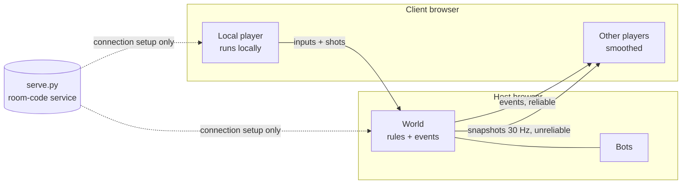

<div align="center">

# FRAGLINE

**Fast, neon 2D arena combat that runs in your browser, with bots and LAN multiplayer built in.**

A modern tribute to the Newgrounds classic *Unreal Flash*, built from scratch in Godot 4.7.


</div>

## Why FRAGLINE

- **Opens in a browser tab.** No install and no plugins. It runs on WebGL 2 using Godot's no-threads web build, so it works on any static host without special server headers.
- **Small download.** All the game data (art, levels, sound and music) is about 4 MB. Every character, weapon, level and effect is drawn in code, so there are no sprite sheets.
- **Bots that play properly.** Bots find their way around every arena using ladders, jump pads and drop-through floors. They pick up items, avoid traps, lead their shots and dodge. There are five skill levels, from Rookie to Godlike.
- **LAN multiplayer with a room code.** Host a match and share a 6-character code. Up to 8 players connect directly to each other, browser to browser, over WebRTC.
- **Tested.** Four headless test suites cover combat rules, menus, bot navigation and full bot matches on every arena.

## Screenshots

| Foundry | Cryo Station |
|---|---|
|  |  |
| **Match setup** | **Customize** |
|  |  |

## Features

### Combat
- **9 weapons, each with an alternate fire mode:** Enforcer, Flak Cannon, Minigun, Shock Rifle (beam + combo ball), Pulse Gun, Rocket Launcher (volleys, rocket jumps), Grenade Launcher (sticky grenades), Sniper Rifle (headshots, wall-piercing shot) and the Redeemer.
- **Movement:** double jump, dodge-roll, drop-through platforms, ladders you can grab in mid-air, and jump pads.
- **Status effects:** burning, poisoned, chilled and jammed.
- **Smooth on fast screens:** physics runs at 60 Hz and rendering is interpolated, so the game stays smooth on 120 and 144 Hz displays.

### Arenas
- **Six PvP arenas:** Deck-17, Skyline, Foundry, Overgrowth, Cryo Station and Orbital. Each one is mirrored for fairness and has its own hazards: laser gates, floor vents, lava and void.
- **No spawn camping:** spawn rooms sit behind energy barriers and you can't fight inside them. A timer stops players from hiding in them, and you get a short shield when you step out.
- **Training Room:** an armory, a firing range, an agility course, and practice dummies you can set up (idle, moving, attacking or bot opponent), plus god mode and infinite ammo.

### Bots
- They plan routes over a navigation graph that covers walking, jumping, double jumps, drop-throughs, ladders and jump pads.
- They choose what to do (heal, armour up, grab a weapon, hunt, roam) by scoring each option.
- In a fight they pick a weapon for the range, lead moving targets, arc grenades, aim rockets at your feet, set up shock combos, and strafe, hop and dodge.

### Multiplayer (LAN)
- Host or join with a room code or a join link. Players can join after a match has started.
- The host's game makes the final call on damage, pickups and scores. It checks each client's fire rate, ammo, weapon ownership and muzzle position.
- Your own movement runs locally, so it never feels laggy. Other players are updated 30 times a second and smoothed between updates. The host's bots fight alongside everyone.

### Presentation
- 12 fighters you can recolour, plus helmets and a live preview.
- Neon lighting, particles and screen shake.
- A full menu flow: start menu over a live bot match, match setup, settings (audio, graphics, key rebinding, gameplay), pause menu, results screen, countdown and an FPS counter.
- A CC0 soundtrack: a synthwave menu theme and a drum-and-bass / trance track for each pair of arenas.

## Quick start

### Play in the browser (recommended)

Requires **Godot 4.7.2** on your `PATH` and its **web export templates** (Editor → Manage Export Templates).

```bash
./tools/build_web.sh        # export to build/web/
python3 tools/serve.py      # serve at http://localhost:8000 (also on your LAN, with gzip)
```

### Play on desktop

```bash
godot --path .              # run the game
godot -e --path .           # open the editor
```

### LAN multiplayer

1. On one machine, run `./tools/build_web.sh` and then `python3 tools/serve.py`. It prints a LAN address such as `http://192.168.1.20:8000`.
2. Everyone opens that address in a browser.
3. The host chooses **Play → Host LAN**, sets up the match and clicks **Host match**.
4. Everyone else chooses **Play → Join LAN** and types the room code, or opens the join link shown in the lobby.
5. The host clicks **Start**.

Use `python3 tools/serve.py --host 127.0.0.1` to keep the server on this machine only.

## Controls

| Action | Keys |
|---|---|
| Move | A / D (or arrow keys) |
| Jump, double jump, climb | W / Space |
| Drop through, climb down | S |
| Dodge | Shift (or S + direction) |
| Fire / alt fire | Left / right mouse button |
| Switch weapon | 1–9, mouse wheel, Q / E |
| Scoreboard | Tab |
| Pause | Esc |
| Training panel | T (in the Training Room) |

You can change any key in **Settings → Controls**.

## How it works



- **Events at the core.** The `World` node announces every game event (shots, hits, pickups, kills). Single-player handles those events locally. In multiplayer the host sends the same events to every client, so both modes run the same rules code.
- **Connections.** `tools/serve.py` serves the game and swaps WebRTC connection details using the room code. Once players are connected, game traffic goes straight between browsers and never passes through the server.
- **Levels are plain text.** Each arena is ASCII art in `src/data/maps.gd`, and the game builds collision, decoration, items and the bot navigation graph from it.
- **One place for balance numbers.** Weapons, projectiles, status effects and traps each have a single table (`weapons.gd`, `status.gd`, `traps.gd`).

## Tests

The dev tools live in `src/dev/` and are left out of exported builds.

```bash
godot --headless --path . -- --test=combat                # rules and mechanics
godot --headless --path . -- --test=menu                  # menus and match flow
godot --headless --path . -- --test=nav                   # bot navigation on every map
godot --headless --fixed-fps 60 --path . -- --test=bot    # bots play every arena (fast-forwarded)
godot --path . --rendering-driver opengl3 -- --shots=/tmp/fragline-shots   # screenshot every map
```

## Deploying

The web build is a plain static site. It works on itch.io, GitHub Pages, Cloudflare Pages, Vercel or any other static host. Turn on gzip or brotli on the host: it shrinks the engine's `.wasm` file from about 39 MB to about 10 MB. Joining LAN matches needs the web build, because desktop builds would need Godot's `webrtc-native` extension.

## Project layout

```
src/
  autoload/   settings (preferences, audio, input rebinding), sfx (pooled audio), music, net (rooms + WebRTC)
  data/       weapons, characters, maps (ASCII arenas), status effects
  game/       world (rules + events), player, level building, projectiles, pickups, traps,
              fx, hud, bots (nav_graph, bot_brain), training room, shaders
  ui/         menus, settings, theme, character and map previews
  dev/        headless tests and the screenshot tool (not exported)
assets/       audio (Kenney, CC0), music (The Cynic Project, CC0), fonts (Chakra Petch, OFL)
tools/        build_web.sh, serve.py
```

## Credits

Built with [Godot Engine](https://godotengine.org). Sound effects are by Kenney, music is by The Cynic Project, and the font is Chakra Petch. See [CREDITS.md](CREDITS.md) for full attribution and licences.

*FRAGLINE is an independent tribute. It shares no code or assets with Unreal Flash or Unreal Tournament.*
