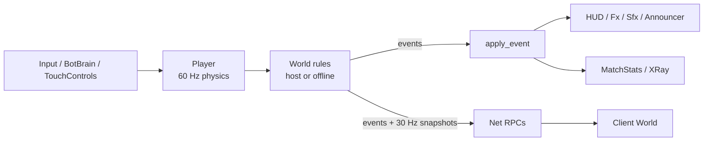

# FRAGLINE architecture

A short tour of how the game is put together. Paths are relative to the repository root.

## Screen flow and the world

`main.tscn` runs `src/main.gd`, which owns the screen flow: the menu (with a live bot match behind it), a match or the Training Room, then results or pause, then back to the menu. It also starts LAN matches and the benchmark, and runs dev tools (`--test=`, `--shots=`).

A match is one `World` node (`src/game/world.gd`). It runs the authoritative rules (firing, damage, deaths, pickups, scoring) and turns every outcome into an **event** (`World.Ev`: SPAWN, DIED, HIT, SHOT, PROJ_END, PICKUP, STATUS, END, JOIN, LEAVE) handled by `apply_event()`. Everything that reacts to the game hangs off those events: HUD, effects, sounds, announcer, X-Ray and `MatchStats` (which listens to `World.event_applied`, so stats come out the same offline, on a LAN host and on clients).

Arenas are ASCII art in `src/data/maps.gd`. `Level` turns the grid into merged collision rectangles and a static tile layer, `LevelDecor` adds set dressing, and `NavGraph` builds the bot navigation graph from the same grid.

## Rendering

The game uses the GL Compatibility renderer (WebGL 2 on the web). In that renderer every `draw_circle`, `draw_polygon`, `draw_polyline` and `draw_arc` is its own draw call with fresh GPU buffers, which held a budget laptop at 17-20 FPS. Two helpers fix that:

- **`DrawUtil`** (`src/game/draw_util.gd`) draws every dynamic shape (discs, glows, lines, rings, polygons) as a 4-point textured primitive sampled from one 256x64 atlas. Consecutive DrawUtil shapes, even across canvas items, collapse into one instanced draw call. Fighters (`CharPainter`), `Fx` pools, pickups and projectiles all use it. Gun sprites come from a single atlas too (`GunSprites`), drawn on a shared layer so every fighter's gun lands in one batch.
- **`StaticDraw`** (`src/game/static_draw.gd`) records flat shapes once and bakes them into one `ArrayMesh` per static layer (tiles, decoration, lights, parallax backgrounds). Unlike baking to a texture, it stays sharp at any zoom.

Nodes redraw only when their state changes. `Fx` uses fixed-size packed arrays with swap-remove, so nothing allocates mid-match. Result: about 40 draw calls a frame and 68 FPS (display refresh) in Chrome on Intel UHD graphics. `FpsCounter` doubles as the auto-quality guard.

## Networking

`src/autoload/net.gd` handles LAN play: the **host is authoritative** and clients mirror it.

- **Signaling:** `tools/serve.py` serves the build and a small JSON service (`/signal/host`, `join`, `send`, `poll`, `leave`, `info`). Peers swap WebRTC offers, answers and ICE candidates through a 6-character room code, then talk directly. No STUN or TURN: LAN addresses only.
- **Traffic:** clients send their own state (unreliable, ordered) and fire requests (reliable) to the host. The host validates fire rate, ammo, weapon ownership and muzzle position, runs the rules, and broadcasts every event reliably plus a snapshot of all entities 30 times a second (unreliable, ordered). Clients keep their own movement local and smooth everyone else between snapshots.
- All RPCs live on the `Net` autoload so they resolve on every peer, and are forwarded to the active `World`.

## Bots

`BotBrain` (`src/game/bot_brain.gd`) fills a `Player`'s input fields each physics step, exactly as a human would. It perceives (who it can see, who shot it), chooses a goal by utility scoring (enemy, pickup, roam), plans with A* on the `NavGraph` (walk, jump, fall, drop-through, climb, jump-pad links), follows the path link by link while waiting out traps, and fights: picks a weapon for the range, leads targets, and fires after a skill-dependent reaction time. X-Ray (`src/game/xray.gd`) draws this state.

## Game modes

`GameMode` (`src/game/game_mode.gd`) layers rules over Deathmatch through static hooks that `World` calls at fixed points: `configure` (setup), `on_spawn` (loadout), `scale_damage` (Instagib one-shots, Rocket Arena self-damage), `on_kill` (Gun Game demotion, respawn delay), `item_allowed` (disabled pickups) and a `died` listener (Gun Game tier changes). With Deathmatch every hook is a no-op. None run per frame.

## Audio

`Sfx` (`src/autoload/sfx.gd`) plays sounds from fixed pools (28 positional players, 6 UI players), so rapid fire never allocates nodes. Each sound has an optional level trim (`VOLUME`) and a voice limit (`MAX_VOICES`); a further play steals the oldest voice of that sound, so a minigun can't starve explosions. Variants (`flak1-4`, `step1-6`, ...) are picked at random. Sounds from the CC BY-ND pack are listed in `FIXED_PITCH` and always play at pitch 1.0. Everything is preloaded one per frame and, on the web, registered as playback samples so the first shot doesn't stall. The SFX bus has a hard limiter; buses come from `default_bus_layout.tres`. `Music` crossfades between the menu theme and per-arena tracks. The `Announcer` speaks through the browser's speech synthesis with a small priority queue on the JavaScript side.

## Web shell

`tools/web/shell.html` replaces Godot's default loading page. It starts the big downloads early, shows progress and tips, and explains failures (no WebGL 2, download interrupted, out of memory). It drops Godot's "secure context" requirement (fine for a no-threads build) and, on plain-HTTP LAN addresses where Chrome hides `AudioWorklet`, installs a fallback so audio starts. A click-to-play gate unlocks audio and focuses the canvas. The export preset's head include adds touch-friendly CSS and the first-tap fullscreen and landscape request on phones.

## Tests

`src/dev/` (excluded from exports) holds 11 headless suites run with `godot --headless --path . -- --test=<name>`: `combat`, `menu`, `nav`, `bot`, `regress`, `mode`, `touch`, `announcer`, `stats`, `audio` and `sfx_hooks`. `main.gd` loads only `res://src/dev/<name>_test.gd`. The screenshot tools (`shots.gd`, `menu_shots`, `stats_shot`) and the native benchmark (`--bench=`) need a real window. See the README's [Tests](../README.md#tests) section for the commands.
